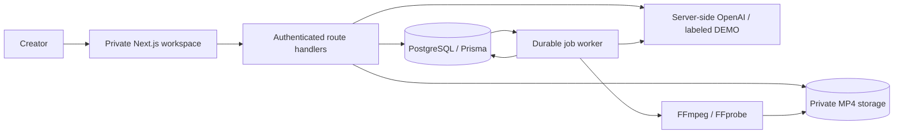

# Architecture · Phase 1

Next.js App Router/React/TypeScript serves a private client workspace and authenticated Node.js route handlers. PostgreSQL is the source of truth; Prisma 7 uses the `pg` driver adapter. Media lives outside the public directory in private local storage. A separately supervised TypeScript worker performs extraction and AI review/comparison.

## Data model

`Project` owns `ScriptVersion`, `EditingTimeline`, `ResearchSource`, `VideoRevision`, `BackgroundJob`, `ApprovalEvent`, and `AuditEvent` records. `VideoRevision` owns immutable `ReviewReport` snapshots for each completed review/comparison. `TopicCandidate` records ideas and their disposition before project creation.

Script versions record language, parent version, the approved ID version an English script is based on, revision instruction and demo provenance. Approval events identify the exact artifact approved, separate from mutable current approval pointers. Timeline scenes are schema-validated JSON snapshots tied to an English version. Videos are unique per project/revision number, with actual metadata, content hash and extracted frame references. Current review/comparison JSON is a convenient projection; reports retain historical outputs and context IDs. Preferences are fixed defaults plus per-project duration/category in Phase 1. Single-user identity is the signed session subject `creator`, not a multi-user table. Voiceover, analytics, TTS and other phase 2/3 entities are intentionally absent.

## Workflow validation

All project commands serialize with a PostgreSQL row lock and execute atomically with audit/approval events. Commands use explicit preconditions rather than trusting a status supplied by the browser. A status string is only a projection of the action just completed.

- Project creation selects a custom topic explicitly: `TOPIC_SELECTED`.
- ID save/generation creates a new version: `INDONESIAN_DRAFT`, both current approvals cleared.
- Latest ID approval: `INDONESIAN_APPROVED`.
- EN generation/save requires the latest ID approved: `ENGLISH_DRAFT`, EN approval cleared.
- Latest EN approval requires matching ID provenance: `ENGLISH_APPROVED`.
- Timeline requires current EN approval: `EDITING_PLAN_READY`.
- Video upload requires a current timeline and valid MP4: `VIDEO_REVIEW_PENDING`.
- Completed worker job: `VIDEO_REVIEWED`.
- Final approval requires a reviewed video whose ID/EN/timeline context matches current artifacts, and no active project jobs: `FINAL_APPROVED`.
- Explicit reopen: `REVISION_REQUESTED`, historical approvals retained.

Downstream artifacts are never deleted when upstream input changes; provenance mismatch is shown as Needs Review. Jobs capture production context and reject stale results if it changes during generation. Upload numbering is protected by a project row lock and a unique database constraint. Repeated review/compare clicks while a revision has an active job are rejected, preventing duplicate queued work.

## Modules

- `src/lib/contracts.ts`: Zod contracts, media admission, duration estimates and gate helper.
- `src/lib/workflow.ts`: validated project commands and transaction/audit boundary.
- `src/lib/ai.ts`, `prompts.ts`: server-only provider calls, strict structured outputs and explicit fixtures. No API key is returned by the status endpoint.
- `src/lib/media.ts`: bounded FFprobe/FFmpeg execution, sampling and private path construction.
- `src/worker.ts`: durable job claims, heartbeats, progress, persisted reports and stale context checks.
- `src/lib/auth.ts`: session signatures, password comparison, CSRF origin and basic rate limits.
- `src/app/api/[...path]/route.ts`: project/topic endpoints, upload admission and authenticated range-enabled media streaming.
- `src/components/`: responsive dashboard, project creation, source capture, versioned editors, timeline and video review workspace.

Use one web instance for in-memory rate limits; the queue supports atomic claims across workers. HTTP generation calls have a 120-second provider timeout, project transaction timeout 180 seconds. Video jobs run outside the upload HTTP request. This is a single-creator MVP; distributed throttling, a multi-user ownership model, object storage adapters and external job supervision belong to a separate operational expansion.
